# OpenNT

[](docs/site/ntoskrnl.html)
[](docs/site/o-que-roda.html)

**OpenNT** é um kernel x86-64 escrito em Rust `no_std`, com a arquitetura do
Windows NT, capaz de **carregar e iniciar drivers `.sys` reais do Windows**.
HAL, nanokernel e executive (Ke, Mm, Io, Ob, Ps, Se, Ex, Cm, Rtl, ALPC, Po,
Etw…) são implementados do zero; um carregador de PE32+ mapeia os binários da
Microsoft, resolve suas importações contra a tabela de exports do próprio
kernel e executa o `DriverEntry` com os mesmos layouts de estrutura, NTSTATUS
e convenção de chamada do NT. O boot (setor de boot + stage2) é Assembly
montado pelo próprio `rustc`; todo o resto é Rust, sem bibliotecas externas.
O `cargo xtask` cuida do build, da imagem de disco, do QEMU e dos testes.

Não é um emulador nem uma máquina virtual: é um núcleo de sistema operacional
que fala a mesma ABI binária que os drivers do Windows esperam.

```
┌── um .sys real do Windows (ex.: i8042prt.sys, kbdclass.sys, cng.sys) ──┐
│  importa ExAllocatePoolWithTag, IoCreateDevice, KeInitializeSpinLock…  │
└───────────────────────────────┬───────────────────────────────────────┘
                                 │ carregado pelo loader de PE do OpenNT
                 ┌───────────────▼────────────────┐
                 │  OpenNT — kernel NT em Rust     │
                 │  Ke · Mm · Io · Ob · Ps · Se    │
                 │  Ex · Cm · Rtl · HAL · loader   │
                 └───────────────┬────────────────┘
                                 │ roda em 64 bits, SMP, no QEMU
                        ┌────────▼────────┐
                        │  x86-64 / QEMU  │
                        └─────────────────┘
```

## O que já funciona

- **Boot x86-64 e SMP.** O sistema sai da BIOS, entra em modo de 64 bits, monta
  IDT/GDT, calibra o timer do LAPIC (100 Hz) e acorda os outros processadores
  (4 CPUs no QEMU).
- **Executive do NT.** Banco de páginas físicas, pool, KPCR, IRQL, DPCs, APCs,
  timers, o dispatcher e processos/threads com `EPROCESS`/`KTHREAD` reais; o
  Object Manager com namespace (`\Device`, `\Driver`, `\GLOBAL??`, `\FS`, `C:`…),
  handles, callbacks, push locks e rundown; tokens e segurança; Configuration
  Manager (Registro); ETW.
- **Drivers reais do Windows carregados e iniciados**, com a `ci.dll` original
  validando a integridade das imagens:
  - **Teclado de ponta a ponta:** `i8042prt.sys` + `kbdclass.sys` da Microsoft —
    o shell recebe as teclas pela pilha PnP real.
  - **Armazenamento:** `ataport`, `atapi`, `disk`, `classpnp`, `mountmgr`;
    **mouse:** `mouclass`; **criptografia:** `cng.sys`.
  - **Bibliotecas de export** importadas por esses drivers: `wmilib.sys` e
    `WppRecorder.sys`.
  - **Vídeo:** o núcleo gráfico `dxgkrnl.sys` (com o `watchdog.sys`) inicia e
    cria `\Device\DxgKrnl`, o primeiro passo da pilha gráfica real.
- **Mais de 900 símbolos** que o `ntoskrnl.exe` do Windows 10 22H2 exporta aos
  drivers já são oferecidos pelo OpenNT (de ~3.070 no total), implementados com
  a semântica real de cada função.
- **NTFS** de leitura e escrita, sistema de arquivos em memória, carregador de
  PE32+ com relocações e IAT, controle de serviços (`sc`) e processos de modo
  usuário com SYSCALL/SYSRET.
- **Suíte de autotestes** que compila sem avisos e passa inteira no QEMU
  (`cargo xtask test-boot`), cobrindo cada subsistema e cada export novo.

## Estado por fase

O OpenNT avança em fases, descritas no [roadmap](docs/ROADMAP.md). Cada fase
termina com o kernel compilando, bootando no QEMU e passando nos autotestes
daquela parte.

| Fase | Escopo | Estado |
| --- | --- | --- |
| 1 — base | boot, HAL, nanokernel, relógio, escalonador, sistema de arquivos em memória, vídeo, console, teclado, shell, `xtask` | ✅ concluída |
| 2 — memória e CPU | páginas físicas, mapeamento recursivo, pool, imagens carregadas, KUSER_SHARED_DATA, KPCR, IRQL, DPC, multiprocessador, ACPI, estruturas do NT | ✅ concluída |
| 3 — objetos e executive | Object Manager, Rtl, Ex, Se, Ps | ✅ concluída |
| 4 — I/O e armazenamento | I/O Manager, ACPI/PCI, energia, ETW, barramentos, disco ATA, NTFS | ✅ concluída |
| 5 — Registro e serviços | Configuration Manager, `sc` | ✅ concluída |
| 6 — loader PE e ntoskrnl | carregador de PE, funções exportadas pelo kernel, drivers reais, KsecDD | 🚧 em andamento |
| 7 — modo usuário | processos e threads de usuário, ALPC, ntdll/KERNEL32 reais | 🚧 em andamento |

As fases 6 e 7 seguem crescendo: cada driver real que se tenta carregar revela
as funções do `ntoskrnl` que ainda faltam, implementadas uma a uma com a
semântica do NT e cobertas por autoteste.

## Estado — o site gerado do código

Cinco páginas HTML estáticas (sem rede: abra os arquivos de `docs/site/` no
navegador) mostram onde o OpenNT está, sempre a partir dos dados:

- **[Início](docs/site/index.html)** — o que é o OpenNT, os números principais,
  o marco atual e o próximo.
- **[O que roda](docs/site/o-que-roda.html)** — cada binário real da Microsoft
  que o OpenNT carrega (drivers e programas) e os marcos: o estado (Roda,
  Parcial, Não roda), o que funciona, onde para, o teste que prova e a tela do
  QEMU no fim desse teste.
- **[Componentes](docs/site/componentes.html)** — as partes do kernel, o estado
  de cada uma e o teste que a cobre.
- **[Exports](docs/site/ntoskrnl.html)** — quantas das ~3.070 funções e
  variáveis do `ntoskrnl.exe` do Windows 10 22H2 o OpenNT oferece, por prefixo,
  com busca.
- **[Testes](docs/site/testes.html)** — como validar (`cargo xtask test-all`) e
  cada teste de boot, com o comando e o marcador.


Para regenerar páginas, selos, gráfico e roadmap depois de mudar o kernel, e
as capturas de tela de cada teste:

```powershell
cargo xtask status                    # não compila o kernel
cargo xtask capturas                  # roda cada [[teste]] e grava docs/site/capturas/<id>.png
cargo xtask capturas --only=ntfs,acpi # só estes
```

A lista de referência dos exports do Windows fica em
[`docs/status/ntoskrnl-exports.def`](docs/status/ntoskrnl-exports.def) (só os
nomes; nenhum binário da Microsoft entra no repositório). O estado, os testes e
a fase de cada componente, e a lista da página O que roda (`[[roda]]`), ficam em
[`docs/status/components.toml`](docs/status/components.toml), editado à mão e
conferido a cada geração.

## Arquitetura

O código segue a árvore do kernel do Windows NT: um diretório por componente do
executive, cada um dono do seu código **e das rotinas que exporta**
(`ntos/<componente>/exports.rs`). A HAL concentra o hardware e o código x64; o
carregador de PE fica no Mm, como o `sysload` do NT; os autotestes rodam dentro
do kernel, no QEMU.

| Caminho | Responsabilidade |
| --- | --- |
| `boot/` | Setor de boot e stage2 (modo real → protegido → 64 bits) |
| `kernel/src/hal/` | HAL: portas, serial, CPU, memória física, LAPIC, heap, RTC, ACPI, PCI, `HalPrivateDispatchTable`; código x64 em `hal/amd64/` |
| `kernel/src/rtl/` | Suporte do kernel em Rust: serial, locks, erros com NTSTATUS, tempo |
| `kernel/src/nano/` | Interrupções, canais de mensagens, registro de serviços |
| `kernel/src/ntos/` | Executive, um diretório por componente: `ke`, `mm`, `io`, `ob`, `ps`, `se`, `ex`, `cm`, `rtl`, `alpc`, `po`, `etw`, `kd`, `fsrtl` |
| `kernel/src/ntos/inc/` | Layouts das estruturas do WDK e NTSTATUS |
| `kernel/src/ntos/init/` | Boot em fases, configuração de build e a tabela de exports do ntoskrnl |
| `kernel/src/ntos/test/` | Autotestes de boot (`phase3.rs`…`phase7.rs`, `self_test.rs`) |
| `kernel/src/drivers/` | VGA, console, teclado PS/2, barramentos, disco ATA e sistemas de arquivos (`drivers/fs/`: RAMFS e NTFS) |
| `kernel/src/shell/`, `kernel/src/apps/` | Shell e programas de exemplo |
| `xtask/` | Build, PE32+ do kernel, `os.img`, QEMU, `test-boot`, `test-all`, `capturas`, `status`, `debug` |
| `tools/` | Ferramentas de desenvolvimento: `kd-client` (o cliente do depurador do kernel), `kd-gui` (o depurador gráfico `opennt-dbg`), `kd-re` (o depurador de engenharia reversa `opennt-re`) e `kd-mcp` (o servidor MCP `opennt-mcp`, para agentes de IA) |
| `docs/` | Roadmap, arquitetura e o site de status |

A árvore completa, as regras de dependência de cada componente e as convenções
estão em **[docs/ARQUITETURA.md](docs/ARQUITETURA.md)**.

## Requisitos

- **Rust nightly** com `rust-src`, `llvm-tools-preview` e o alvo
  `x86_64-unknown-none`. O [rust-toolchain.toml](rust-toolchain.toml) declara
  tudo; o rustup instala o que faltar no primeiro build.
- **QEMU** (`qemu-system-x86_64`). O `xtask` procura na variável `QEMU`, depois
  no `PATH` e em `C:\Program Files\qemu`.

Não são necessários Python, NASM nem Zig.

## Compilar, executar e testar

```powershell
# Compila boot + kernel e monta build/os.img.
cargo xtask build

# Shell interativo numa janela do QEMU; a serial fica neste terminal.
cargo xtask run

# Boot sem tela até um marcador da serial (padrão KERNEL_RS_OK).
cargo xtask test-boot

# Suíte completa de autotestes.
cargo xtask test-boot SELFTEST_OK 60000 --kernel-test-scope=all --build-dir=build/tests --expect=MULTIPROCESS_OK

# Digita no shell pelo monitor do QEMU e confere a saída.
cargo xtask test-boot KERNEL_RS_OK 120000 "--keys=run hello\nps\n" "--expect== 42"

# Inicia drivers reais do Windows pelo gerenciador de serviços (watchdog.sys e o
# núcleo gráfico dxgkrnl.sys).
cargo xtask test-boot DRIVER_START_COMPLETED 300000 --start-driver=watchdog --build-dir=build/watchdog --smp=1 "--expect=name=watchdog state=4 win32=0"
cargo xtask test-boot DRIVER_START_COMPLETED 300000 --start-driver=DXGKrnl --build-dir=build/dxgkrnl --smp=1 "--expect=name=DXGKrnl state=4 win32=0"

# O smss.exe real como primeiro processo, até o csrss.exe que ele cria.
cargo xtask test-boot SMSS_CSRSS_OK 300000 --initial-process=smss --build-dir=build/smss --smp=1

# O mesmo boot com o win32k.sys real carregado pelo smss da sessão.
cargo xtask test-boot WIN32K_LOADED 420000 --initial-process=smss --build-dir=build/win32k --smp=1 --expect=SMSS_CSRSS_OK "--expect=thread GUI pelo PsConvertToGuiThread -> 0x0"

# Com o adaptador de vídeo: o NtUserInitialize do csrss faz o dxgkrnl.sys
# iniciar o BasicDisplay.sys real e volta com sucesso.
cargo xtask test-boot BASICDISPLAY_OK 600000 --initial-process=smss --display=basic --build-dir=build/win32k-display --smp=1 --expect=SMSS_CSRSS_OK --expect=ADAPTER_STARTED --expect=USER_INITIALIZED

# A validação inteira: as duas suítes completas (4 CPUs e 1) e todos os
# [[teste]] de docs/status/components.toml, em paralelo, cada execução em
# build/test-all/<id>; no fim, a tabela e o trecho da serial de cada falha.
cargo xtask test-all
cargo xtask test-all --jobs 4 --cpu-friendly
cargo xtask test-all --only dxgkrnl --repeat 10

# Depurador do kernel: build com --kd=com2, QEMU e o prompt do cliente
# (comandos do WinDbg: k, r, db/dq, bp, bu, ba, bl, g, p, t, gu, lm, dt,
# !process, !thread, !irp, !devobj, !drvobj, !analyze; trace; help).
cargo xtask debug
# Só o cliente (ou um GDB: target remote 127.0.0.1:1234) contra
# `cargo xtask run --kd=com2`.
cargo xtask debug --connect=127.0.0.1:1234
# O teste automático do depurador (roteiro xtask/scripts/kd.txt).
cargo xtask test-boot KD_EXPORTS_OK 600000 --kd=com2 --script=xtask/scripts/kd.txt --build-dir=build/kd --start-driver=ksecdd --expect=KERNEL_RS_OK --expect=KD_SESSION_DETACHED --hold=5000

# O depurador gráfico (opennt-dbg): o mesmo build e QEMU do cargo xtask debug,
# numa janela no estilo do WinDbg. Opções do xtask passam adiante (--accel=whpx).
cargo run -p kd-gui --release -- --launch
cargo run -p kd-gui --release -- --connect=127.0.0.1:1234
# Testes do cliente e o teste de fumaça do depurador gráfico (abre o QEMU).
cargo test -p kd-client
cargo test -p kd-gui --release -- --ignored --nocapture

# O depurador de engenharia reversa (opennt-re): kernel e processos de usuário.
# Com --initial-process=smss o csrss.exe real roda e pode ser depurado.
cargo run -p kd-re --release -- --launch --initial-process=smss --smp=1
cargo test -p kd-re --release -- --ignored --nocapture
# Snapshots da máquina (discos em overlays qcow2) e gravação/reprodução do
# QEMU com os passos para trás (só TCG; veja os limites abaixo).
cargo run -p kd-re --release -- --launch --vm-snapshots
cargo xtask debug --record=build/gravacao.bin --smp=1
cargo xtask debug --replay=build/gravacao.bin

# O servidor MCP (opennt-mcp) para agentes de IA: stdio ou HTTP local.
cargo build -p kd-mcp --release
cargo test -p kd-mcp
cargo test -p kd-mcp --release -- --ignored --nocapture

# O site de status (docs/site), os selos e o roadmap; as capturas de tela
# do fim de cada [[teste]] (docs/site/capturas/<id>.png).
cargo xtask status
cargo xtask capturas

# Estruturas do NT (kernel/src/ntos/inc/types) geradas dos símbolos do
# ntoskrnl, com a lista em types/nt_types.toml; o PDB vai para build/symbols
# (baixado do servidor público de símbolos na primeira vez). --check só confere.
cargo xtask nt-types
cargo xtask nt-types --check
```

Opções de build: `--release`, `--build-dir=DIR`,
`--kernel-test-scope=none|all|disk-stress` (`disk-stress` roda só a estressa
do caminho de escrita do disco, com leitores em outras CPUs, e imprime
`DISK_STRESS_OK`), `--start-driver=NOME` (inicia o serviço pelo gerenciador de serviços, com a
integridade de código ativa, e imprime `DRIVER_START_COMPLETED`),
`--trace-driver-api` (mostra cada chamada de API do driver enquanto ele inicia:
objetos abertos, rotinas pedidas ao `MmGetSystemRoutineAddress`, valores do
Registro e texto formatado), `--initial-process=smss` (o primeiro processo de
usuário passa a ser o smss.exe real, que monta a sessão e cria o csrss.exe; o
build põe no volume os binários dessa cadeia e o kernel deixa de montar o
`\KnownDlls` e de imitar o csrss).
No `cargo xtask debug`: `--vm-snapshots` (os discos em overlays qcow2 em
`<build>/snapshots`, para o `savevm`/`loadvm` do monitor do QEMU),
`--record=ARQ` (a gravação do QEMU, com os discos em overlays ao lado do
arquivo) e `--replay=ARQ [--gdb-port=N]` (a reprodução, com o gdbstub do
QEMU no lugar do depurador do kernel).
Opções de máquina: `--accel=tcg|whpx`,
`--memory-mb=N` (padrão 4096), `--smp=N` (padrão 4). Em `--keys`, `\n` digita
Enter; `--expect` pode se repetir. O `test-boot` falha se a serial mostrar
`*** PANIC`, `*** EXCECAO` ou `SELFTEST FALHOU`. Com `--build-only` ele só
monta a imagem do teste; com `--no-build` roda o QEMU na imagem já montada em
`--build-dir` (ou, com `--image-dir=DIR`, nas imagens de DIR, deixando em
`--build-dir` só a cópia do `os.img` e os logs); com `--capture=ARQ.png`, no fim
do teste (passando ou não) grava a tela do QEMU nesse PNG, pelo `screendump` do
QMP. O volume NTFS entra no QEMU do `test-boot` com `snapshot=on`: todo teste
começa do volume que o build montou.

As opções de boot (`--kernel-test-scope`, `--start-driver`, `--kd`,
`--initial-process`, `--storage`, `--display`, `--pnp-root`,
`--trace-driver-api`, `--console-mirror`, `--user-program`) não recompilam o
kernel: vão no bloco de opções de carga da imagem de boot (como as opções de
boot do Windows no LoadOptions do loader), que o kernel lê ao entrar e mostra
na serial (`[boot] opcoes de carga: ...`). Só o `--initial-process=smss` muda
também o volume NTFS. Um kernel compilado serve a todo `--build-dir`.

O `test-all` compila o kernel uma vez e monta as imagens uma vez por volume
(`build/test-all/imagem-<n>`: a do boot comum e a do smss), e roda o QEMU em
`--jobs=N` pistas (`test-boot --no-build --image-dir`; padrão: metade das
CPUs), cada execução com as próprias opções de carga. Cada QEMU compromete
toda a memória do convidado ao subir, então um QEMU só começa quando o
commit livre do host o cobre com folga.
Opções: `--only=ID,...`, `--skip=ID,...`, `--suite` (só as suítes,
`suite-smp4` e `suite-smp1`) ou `--no-suite`, `--repeat=N` (cada teste N
vezes, para caçar falhas intermitentes), `--keep` (guarda a pasta de toda
execução e das imagens; sem ele, só as das falhas ficam, com `test-boot.log` e
`serial.log`, e as imagens que elas usaram, com o `build.log`), `--cpu-friendly` (o test-all, o cargo e o QEMU com prioridade
abaixo do normal e sem 4 CPUs lógicas na afinidade) e `--list` (mostra os
testes e os comandos). No `components.toml`, `espera_falha = true` marca uma
falha conhecida, contada à parte sem reprovar a rodada, e
`coberto_pela_suite = true` um teste cujos marcadores as suítes já conferem
(só roda com `--only`). O comando sai com erro se alguma execução falhar.

Para carregar um driver real, o build copia do Windows da própria máquina os
`.sys`/`.dll` de que ele precisa (hal.dll, i8042prt, kbdclass, atapi, cng.sys,
ci.dll…) e os coloca no volume NTFS da imagem. **Nenhum binário da Microsoft ou
de terceiros entra no repositório.**

Comandos do shell: `help`, `version`, `clear`, `echo`, `mem`, `ls`, `cat`,
`write`, `rm`, `run hello`, `spawn pisca`, `ps`, `kill`, `sc`, `halt`.

### Depurador do kernel

O OpenNT tem o próprio depurador de kernel. Com `--kd=com2` o kernel atende o
protocolo remoto do GDB na COM2, com consultas próprias. Há dois clientes com
o mesmo código (`tools/kd-client`): o prompt de texto `cargo xtask debug` e o
depurador gráfico `opennt-dbg` (`cargo run -p kd-gui --release -- --launch`).

- Pilha correta através dos drivers da Microsoft: desenrolar pela `.pdata`
  deles e pelos frame pointers do OpenNT, com os nomes dos PDBs públicos
  (baixados do servidor de símbolos para `build/symbols`):
  `ACPI!ACPIDispatchAddDevice+0xc8`.
- Objetos do NT: processo, thread (estado, motivo da espera, pilha), IRP
  (pilha de E/S), dispositivo (pilha de dispositivos), driver (tabela de
  despacho), objeto por nome ou handle, módulo e qualquer struct do PDB do
  ntoskrnl campo a campo (`dt _IRP endereço`).
- Bugcheck: numa parada pelo KeBugCheckEx, a análise abre sozinha com o
  nome do código, os parâmetros explicados, o driver culpado e a pilha.
- Breakpoints condicionais e com contagem, de dados (escrita, acesso,
  execução), adiados para um módulo que ainda vai carregar e parada na carga
  de um módulo (`sxe ld:ntfs.sys`); a lista volta na próxima sessão.
- Rastro de instruções passo a passo dentro do convidado, em lotes: N
  instruções, até um endereço, até o retorno, até entrar ou sair de um
  módulo, só a função corrente. Tabela com os registradores e os operandos
  de memória de cada passo, árvore de chamadas, CSV e comparação de dois
  rastros. No TCG, um rastro rápido pelo log de execução do QEMU.
- Janela: desmontagem, código-fonte e variáveis locais (DWARF do kernel),
  registradores, observação com structs tipadas, memória em vários formatos
  com busca, pilha, breakpoints, módulos, threads, processos, objetos do NT,
  rastro, comandos com histórico e Tab, DbgPrint e o log da COM1, em painéis
  encaixáveis. O arranjo fica salvo; o menu Painéis reabre um painel e
  restaura o padrão. Tema escuro e claro.
- Teclas do WinDbg: F5 continua, F10 passa por cima, F11 entra, Shift+F11
  sai da função, F9 liga ou tira um breakpoint, Ctrl+B para.

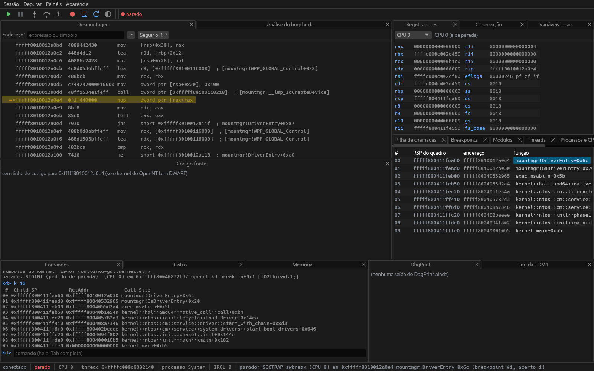

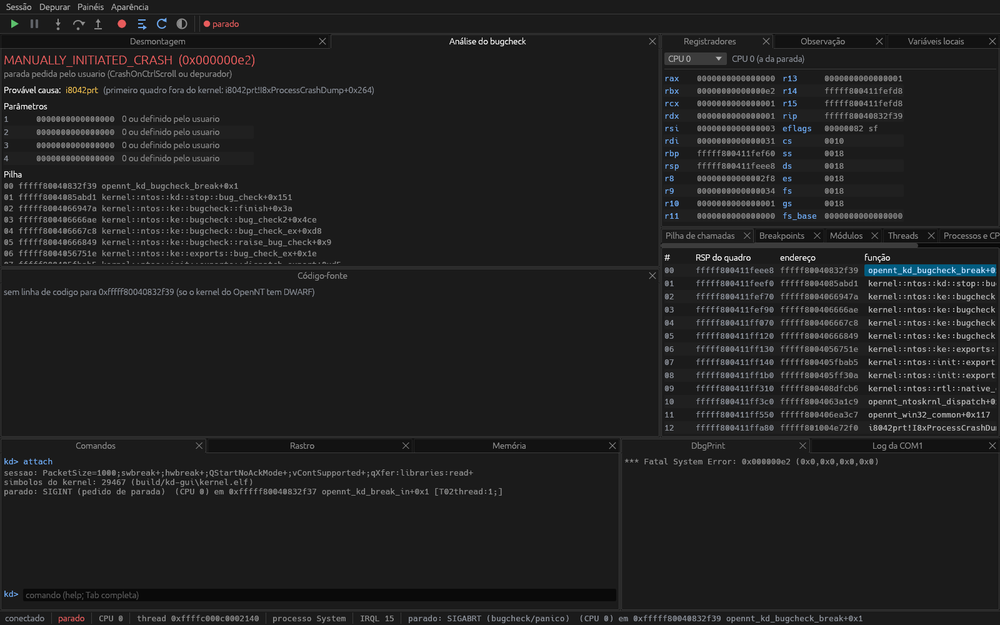

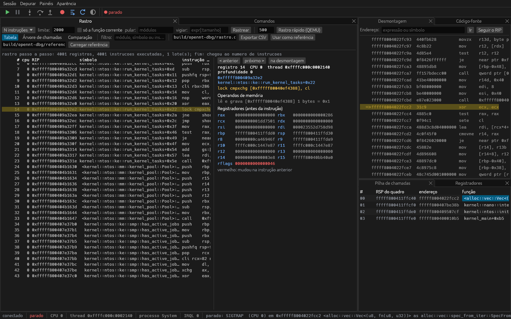

### Depurador de engenharia reversa (opennt-re)

O `opennt-re` (`tools/kd-re`) usa o mesmo cliente e o mesmo depurador do
kernel, com o layout dos depuradores de engenharia reversa: abas no alto e a
aba CPU com quatro painéis. Serve ao kernel e aos processos de usuário que
rodam no OpenNT (csrss.exe, smss.exe, wininit.exe).

- Processos de usuário: clique duplo na aba Processos escolhe o processo.
  A memória é lida pela raiz dele; os módulos saem da PEB.Ldr e do VAD, com
  os PDBs públicos da ntdll, do CSRSRV e das outras DLLs. Breakpoints de
  usuário só param no processo dono. Parada na criação e na saída de
  processo e de thread e na carga de uma DLL num processo
  (`sxe ld:csrss!basesrv.dll`). Threads de usuário com TEB, início, motivo
  da espera e LastError; a pilha de usuário sai do CONTEXT salvo.
- Aba CPU: desmontagem com as setas dos desvios, a linha do RIP, as
  instruções executadas (do rastro), comentários, rótulos e marcadores,
  caixa de informação com os operandos; registradores com flags e
  segmentos; Dump 1-5 em hexadecimal, texto e tipos; pilha com os endereços
  de retorno nomeados.
- Grafo de fluxo da função (G), com o bloco corrente destacado.
- Procurar: referências a strings (ASCII e UTF-16), constantes, chamadas
  entre módulos e xrefs, num módulo, em todos ou numa faixa; padrões com
  curingas (Ctrl+B); strings soltas. A aba Referências tem filtro por texto
  ou regex, contagem e clique duplo que leva à instrução.
- Patches: Espaço monta uma instrução; a aba Patches desfaz e exporta.
- Breakpoints de log (`bp x /log "rcx={@rcx}"`), com comandos de parada, em
  grupos, condicionais e com contagem; vigia de faixa com até quatro
  comparadores.
- Mapa de memória (imagens com seções e faixas do kernel; regiões do VAD de
  um processo), handles com tipo e nome, pilha com argumentos, tratadores de
  exceção dos quadros (SEH), símbolos, exports e imports por módulo.
- Script: comandos do depurador com variáveis, `if`, `while`, `for` e
  `log`; `--script=arquivo` roda um roteiro depois do attach.
- Análise automática na aba CPU: colchetes das funções (pela `.pdata`,
  pelos símbolos ou pelo fluxo de código) e dos laços na margem;
  comentários nas chamadas a APIs conhecidas com os argumentos
  decodificados (`IoCreateDevice(DriverObject=..., DeviceName=L"\Device\X",
  ...)`, pelos protótipos e pelo preparo de RCX, RDX, R8, R9 e da pilha);
  as strings referenciadas em comentário. X (ou Ctrl+R) abre as
  referências cruzadas do endereço, pelo índice do módulo feito uma vez. H
  liga o destaque: um clique num registrador ou operando marca as
  ocorrências na janela (`eax` também marca `rax`).
- Registradores: além dos gerais, XMM0-XMM15 (hexadecimal, floats ou
  doubles), MXCSR, a metade alta dos YMM quando o sistema liga o AVX, x87 e
  MMX, DR0-DR7, LastError e LastStatus numa parada de usuário e a caixa dos
  argumentos da convenção x64 (RCX, RDX, R8, R9 e a pilha, quantidade
  ajustável).
- Menu de contexto da desmontagem: Breakpoint (software, hardware, memória
  por página, editar, ligar, remover), executar até a seleção (F4), nova
  origem (Ctrl+*), Seguir (desmontagem, dump, mapa de memória, grafo),
  Copiar (endereço, RVA, deslocamento no arquivo, seleção, bytes),
  Binário (editar, preencher, NOP, montar), comentário, rótulo, marcador,
  referências (Ctrl+R) e Procurar. Shift+clique seleciona várias linhas.
- Editor de breakpoints: condição de parada, texto e condição de log,
  comandos e condição de comando, nome, contagem de acertos, uma vez só,
  silencioso e retorno rápido. Breakpoints de hardware em endereço de
  usuário valem só no processo escolhido (DR0-DR3 no CONTEXT das threads
  dele); breakpoints de memória por página (acesso, escrita, execução),
  sem mudar a proteção que o processo consulta.
- Observação com o valor que mudou desde a parada anterior em vermelho.
- Dump: inteiros com e sem sinal de 1, 2, 4 e 8 bytes, float, double,
  ponteiro com símbolo e desmontagem; "sincronizar" segue a expressão a
  cada parada. Pilha com "retorno para X de Y", presa ao RSP ou numa
  expressão.
- Colunas: Pilha de chamadas (Endereço, Para, De, Tamanho, Comentário,
  Parte), Threads (número, ID, entrada, TEB, RIP, suspensão, prioridade,
  espera, LastError, tempos, ciclos) e Mapa de memória (Endereço, Tamanho,
  Parte, Informação, Conteúdo, Tipo, Proteção, Proteção inicial; as regiões
  executáveis em vermelho; gravar a região num arquivo).
- O menu Arquivo liga o servidor MCP na própria janela (127.0.0.1): um
  agente de IA e você usam a mesma sessão.
- Monitor de APIs (aba APIs): cada chamada de um driver (ou de todos) aos
  exports do ntoskrnl e da HAL vira uma linha com o nome do export, os
  argumentos decodificados pelos protótipos (os textos copiados pelo
  próprio kernel na volta da chamada), o resultado com o nome do
  NTSTATUS, a thread, o processo, a hora, a duração e o chamador. Tabela
  virtual com filtros (driver, export, status, só falhas), "ir para o
  chamador" e CSV. Liga e desliga com a máquina parada; os registros
  chegam em lotes com a máquina rodando.
- Rastreador de IRPs (aba IRPs): a vida de cada IRP pelas pilhas de
  dispositivos (quem criou, major/minor, cada IofCallDriver com o
  dispositivo, o driver, a rotina e o status devolvido, as rotinas de
  conclusão, o status final e o Information, os tempos), em linha do tempo
  e detalhe, com filtros por driver, dispositivo e major.
- Snapshots e voltar no tempo (aba Snapshots): com `--vm-snapshots` os
  discos entram como overlays qcow2 e a máquina inteira grava e volta a um
  ponto da parada (`savevm`/`loadvm`). Com `--record=ARQ` o QEMU grava a
  execução (icount, TCG); `--replay=ARQ` a reproduz com o gdbstub do QEMU,
  e "voltar um passo" e "voltar até o breakpoint" andam para trás. A
  barra de estado mostra o modo. Limites: a gravação e a reprodução só
  existem no TCG com um processador (o QEMU recusa mais de um), a
  máquina da reprodução precisa ser a da gravação (a data da CMOS, a
  memória e os processadores ficam em `ARQ.maquina`) e o QEMU precisa
  sair sozinho para o arquivo valer (o depurador manda `quit` ao
  monitor). No QEMU 11.1 desta máquina, a gravação a partir do reset anda
  devagar demais no carregador de boot (as leituras ATA PIO por consulta
  só andam a cada checkpoint da gravação) e o passo na reprodução não
  volta; os snapshots (`--vm-snapshots`) são o jeito de voltar a um ponto
  do kernel.
- Ver como tipo (aba Tipos, menu do Dump): um endereço como qualquer tipo
  do PDB do ntoskrnl (ou de um módulo, `ntdll!_PEB`), em árvore: structs,
  arrays, ponteiros seguidos, listas (LIST_ENTRY pelo Flink, cada entrada
  como a struct que a contém) e campos editáveis.
- Exploradores do convidado vivo: o Registro como o kernel o guarda
  (chaves e valores), o namespace do Object Manager (diretórios, links,
  dispositivos, drivers, com o tipo e o corpo) e os arquivos do volume
  (listar, ver e copiar para o hospedeiro).
- Preferências (menu Aparência): fontes, escala, cores, editor de atalhos
  e paradas em eventos (criação e saída de processo, thread, carga de
  módulo, exceções do anel 3). Comentários, rótulos, marcadores e
  breakpoints ficam num banco por módulo + RVA
  (`<build>/opennt-re/db/<modulo>.json`), gravado e lido sozinho.
- Teclas: F2 breakpoint, F7 entra, F8 passa por cima, F9 executa, Ctrl+F9
  até o retorno, Alt+F9 até o código de usuário, F4 até o cursor, F12
  pausa, Ctrl+G vai para, `;` comentário, `:` rótulo, Espaço monta, Ctrl+B
  padrão, G grafo, X e Ctrl+R referências, H destaque, Ctrl+* nova origem,
  `*` volta ao RIP. Tema claro e escuro.

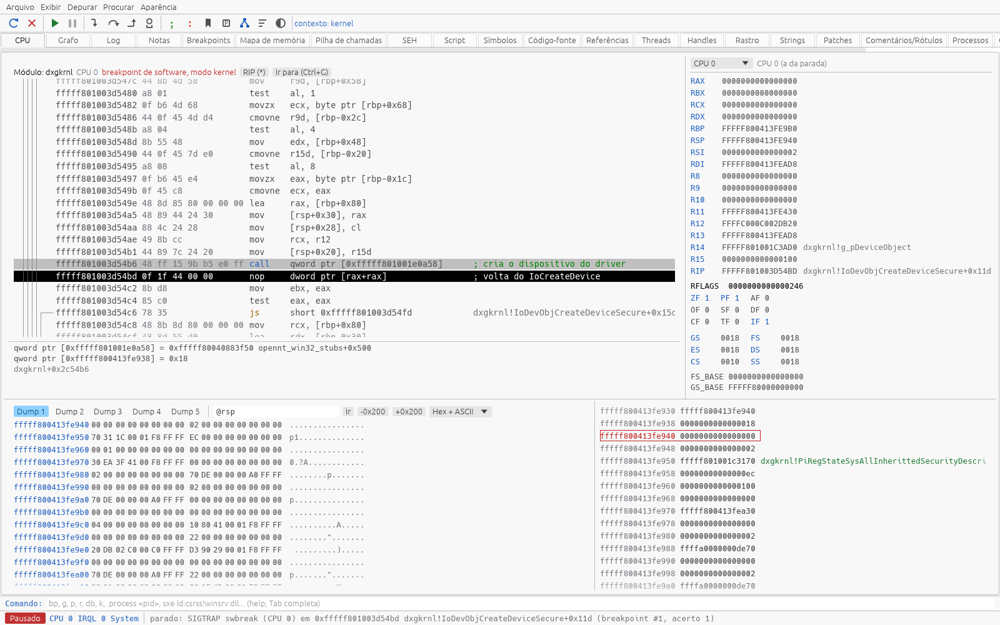

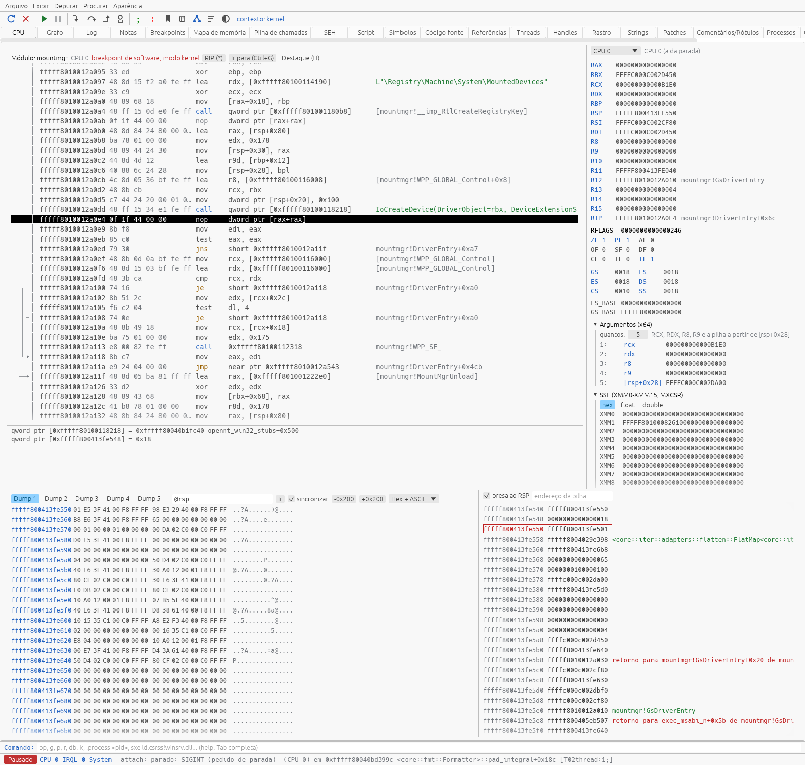

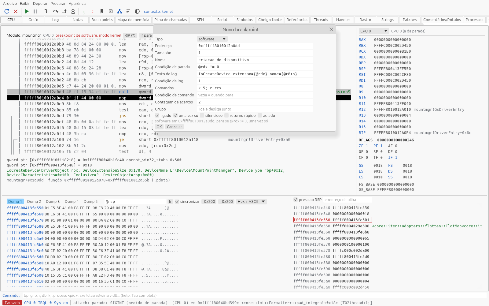

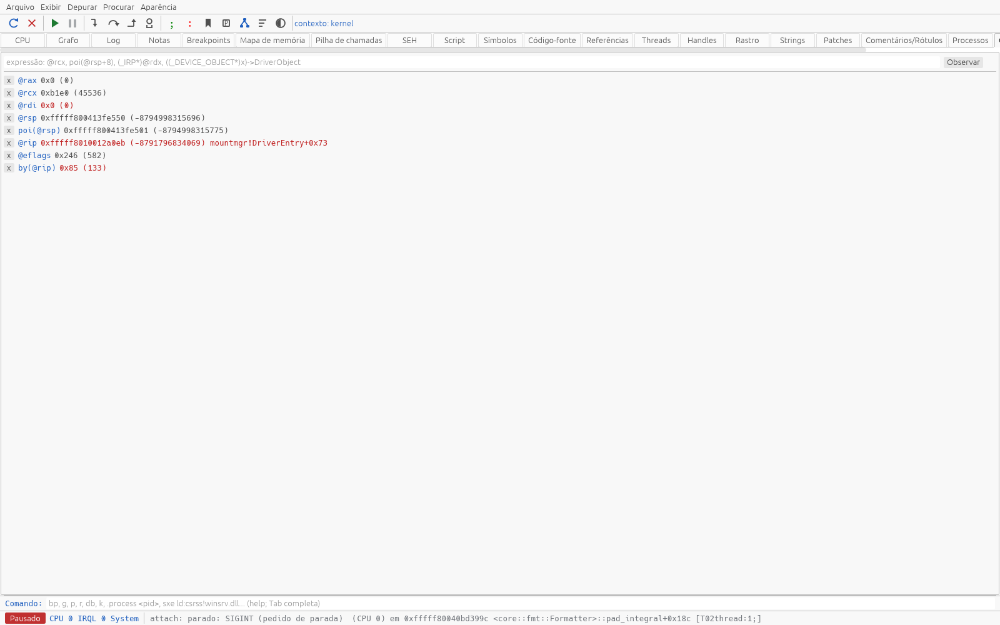

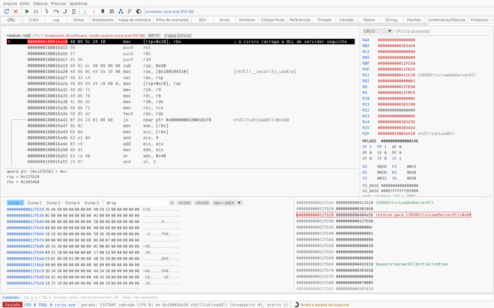

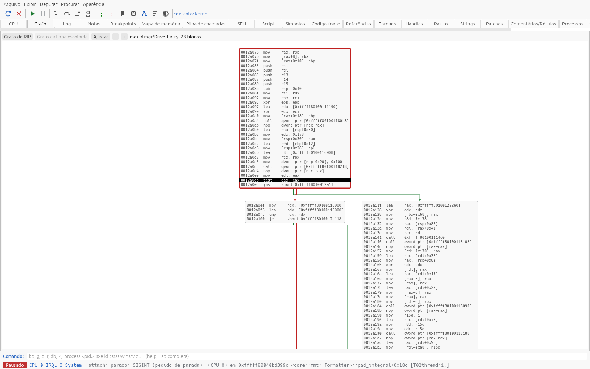

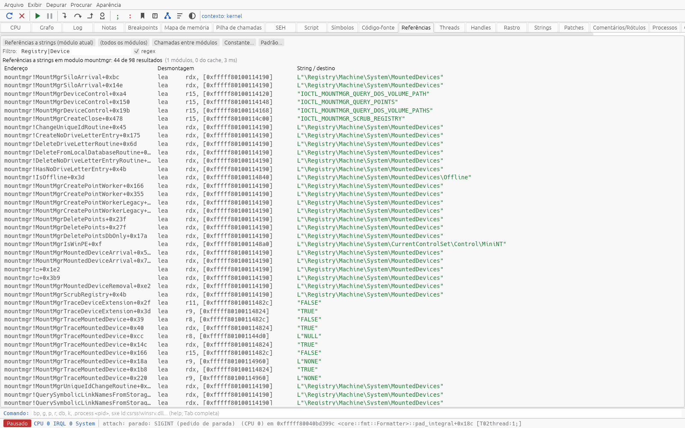

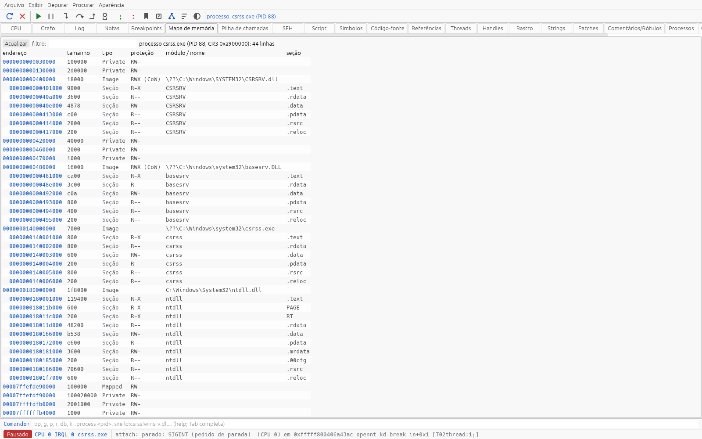

### Servidor MCP (opennt-mcp)

O `opennt-mcp` (`tools/kd-mcp`) deixa um agente de IA dirigir o depurador
pelo Model Context Protocol (JSON-RPC 2.0). Usa o mesmo cliente do
`cargo xtask debug` e do opennt-re.

- Transportes: stdio (uma mensagem por linha) ou HTTP local
  (`--http=PORTA`, só em 127.0.0.1, `POST /mcp`).
- Ferramentas: `launch` (compila e abre o QEMU), `connect`, `detach`,
  `status`, `break`, `go`, `wait_for_stop`, `step_into`, `step_over`,
  `step_out`, `run_to`, `registers_get`, `register_set`, `memory_read`,
  `memory_write`, `disassemble` (com a análise automática),
  `symbol_lookup`, `symbol_resolve`, `modules`, `processes`, `threads`,
  `set_process`, `breakpoint_set` (condição, log, comandos e as opções),
  `breakpoint_clear`, `breakpoint_enable`, `breakpoint_list`, `backtrace`,
  `search_strings`, `search_pattern`, `xrefs`, `nt_view` (`!process`,
  `!thread`, `!irp`, `!devobj`, `!analyze`...), `trace_start`,
  `trace_fetch`, `trace_stop`, `wait_for_serial` (um texto no log da
  COM1), `read_serial_log`, `run_script`, `command`, `screenshot` (a tela
  do convidado em PNG), `api_monitor_start`, `api_monitor_stop`,
  `api_monitor_fetch`, `irp_trace_start`, `irp_trace_stop`,
  `irp_trace_fetch`, `reverse_step`, `reverse_continue`,
  `snapshot_save`, `snapshot_restore`, `snapshot_list`, `view_struct`,
  `registry_list`, `registry_read`, `object_list`, `file_list` e
  `file_read`.
- Recursos: o log da COM1, o DbgPrint, os breakpoints e os módulos.

Para registrar num cliente MCP, use o binário compilado
(`target/release/opennt-mcp`, ou `opennt-mcp.exe` no Windows) com a raiz do
repositório:

```text
opennt-mcp --root=C:/caminho/do/OpenNT
```

Exemplo de configuração (o formato `mcpServers` aceito pela maioria dos
clientes):

```json
{
  "mcpServers": {
    "opennt": {
      "command": "C:/caminho/do/OpenNT/target/release/opennt-mcp.exe",
      "args": ["--root=C:/caminho/do/OpenNT"],
      "env": {
        "QEMU": "C:/caminho/do/qemu/qemu-system-x86_64.exe"
      }
    }
  }
}
```

O `launch` roda `cargo xtask debug --launch --no-client`, então o `cargo`
precisa estar no PATH do cliente. Por HTTP, o endereço é
`http://127.0.0.1:PORTA/mcp`.

## Fora do escopo

- Compatibilidade geral com Windows, drivers de GPU ou jogos. O resultado de um
  driver ou de uma suíte não comprova compatibilidade com outros programas.
- Binários de terceiros nunca entram no repositório; o OpenNT os lê da própria
  máquina em tempo de build.
