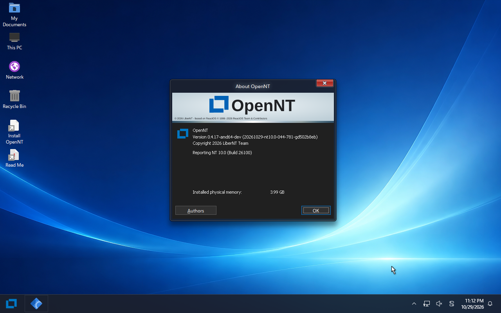

# OpenNT

<p align="center">
  
</p>

**A free NT operating system focused on compatibility with Windows 10 and later, including Windows 10+ device drivers.**

[](https://github.com/JoaoOliveiraJ/OpenNT/actions/workflows/build.yml)
[](COPYING)

[中文](translations/zh-CN/README.md) · [Français](translations/fr-FR/README.md) · [Español](translations/es-ES/README.md) · [日本語](translations/ja-JP/README.md) · [العربية](translations/ar-MA/README.md)

OpenNT develops an open implementation of the NT architecture: the kernel, system services, Win32 environment and driver interfaces needed by modern Windows software. Its compatibility target is **Windows 10 and later (NT 10.x)**, with **AMD64 / x86-64** as the primary development platform.

## Windows 10+ driver support

The project's central goal is to run applications and device drivers designed for Windows 10 and later. Work focuses on:

- NT kernel and I/O interfaces, Plug and Play, power management and driver loading.
- Compatibility with the interfaces used by WDM and Windows Driver Frameworks drivers.
- Graphics, networking, storage, USB and other device classes.
- INF-based installation and the kernel/user-mode components required by driver packages.
- Testing each supported driver against its target Windows version and actual hardware.

**This is a development goal, not a claim that every Windows 10+ driver already works.** Compatibility depends on the APIs and driver-model features implemented, the package's architecture and the device. A successful build or VM boot does not establish compatibility with a hardware driver.

Windows 10+ here includes Windows 11. Windows 11 remains a reference for the inherited NT10 implementation; the project does not revert the kernel to an older NT design. The [Microsoft WDK documentation](https://learn.microsoft.com/en-us/windows-hardware/drivers/develop/building-a-driver) explains how Windows drivers specify their minimum supported Windows version.

## Project status

OpenNT is under active development. Use development images in a virtual machine or on dedicated test hardware.

| Area | Current scope |
| --- | --- |
| AMD64 | Primary 64-bit development target; native Windows build tools and QEMU are used for local validation. |
| 32-bit applications | WoW64 components are included in the AMD64 build. Application compatibility is tested individually. |
| ARM64 and RISC-V64 | Ports inherited from the upstream project; support varies by board and build configuration. |
| i386 and PowerPC | Additional source targets; their status is independent of the AMD64 build. |
| Boot and storage | BIOS/UEFI boot paths, an NTFS system partition and FAT boot partition. |
| Desktop and graphics | Win32 desktop, WDDM-related components, DWM and configurable Mesa support. |

AMD64 development build running in QEMU with Windows Hypervisor Platform:



## Build from source

Clone this repository:

```sh
git clone https://github.com/JoaoOliveiraJ/OpenNT.git
cd OpenNT
```

The build uses **RosBE**, CMake, Ninja, Flex, Bison and Python. Mesa's generators also need the Python packages `mako`, `packaging` and `PyYAML`. The upstream [RosBE toolchain](https://github.com/LiberNT/libernt-build-toolchain) remains an external build dependency.

On Linux or macOS, install the host tools and RosBE, then run:

```sh
./configure.sh -a amd64
ninja -C output-Clang-amd64-debug openntimg
```

The first configuration downloads the source feeds required by the selected features. See `./configure.sh --help` for architecture and build options, or use `./configure.sh menuconfig`.

### Building on Windows

Native Windows builds use the Windows RosBE package and `configure.cmd`. The NTFS image tool additionally needs the POSIX environment provided by **MSYS2**; WSL is not required for this route.

With RosBE's compiler and host tools on `PATH`, configure an AMD64 build:

```bat
set CCACHE_DISABLE=1
call configure.cmd /clang /arch=amd64 -DENABLE_CCACHE=OFF -DDIAGDATA_CHANNEL=
```

For the native Clang toolchain, set `HOST_TOOLS_C_COMPILER` and `HOST_TOOLS_CXX_COMPILER` to the Windows-host compilers in RosBE's `llvm-mingw/bin` directory. Set `HOST_NTFSIMG` to the MSYS2-built `ntfsimg.exe` when producing disk images. The [Windows build guide](doc/build-windows.md) gives the complete setup.

### Build outputs

| Target | Output | Purpose |
| --- | --- | --- |
| `openntimg` | `OpenNT.img` | Preinstalled raw disk image for QEMU or other compatible VMs. |
| `bootcd` | `bootcd.iso` | Bootable installation/live CD image. |
| `openntvhd` | `OpenNT.vhd`, `OpenNT.vhdx` | Virtual disks for compatible hypervisors. |

Outputs are written to the selected `output-*` build directory. Build artifacts are not stored in Git. Available CI builds can be found under [Actions](https://github.com/JoaoOliveiraJ/OpenNT/actions); published packages, when available, belong under [Releases](https://github.com/JoaoOliveiraJ/OpenNT/releases).

## Run in QEMU on Windows

For a host with Windows Hypervisor Platform available:

```bat
qemu-system-x86_64 -name OpenNT -machine pc -accel whpx -m 4096 -smp 4 -drive file=output-Clang-amd64-debug/OpenNT.img,format=raw,if=ide -vga std -usb -device usb-tablet -nic user,model=e1000 -display sdl
```

If hardware acceleration is unavailable, use `-accel tcg` instead. Press **Ctrl+Alt+G** to release the mouse from QEMU. Shut down the VM before rebuilding its disk image.

The USB tablet provides absolute pointer coordinates for precise cursor movement and window dragging. You can also run `scripts\run-qemu.cmd`; set `OPENNT_ACCEL=tcg` when needed, and put QEMU on `PATH` or set `ROSBE_ROOT` to the Windows toolchain directory.

OpenNT Setup is named `opennt.exe`. See [INSTALL.md](INSTALL.md) for installation details.

## Contributing

Report issues and proposed driver-compatibility work at [JoaoOliveiraJ/OpenNT](https://github.com/JoaoOliveiraJ/OpenNT/issues). Include the architecture, build commit, device or driver package, expected behavior on Windows 10+ and the observed result.

Read [CONTRIBUTING.md](CONTRIBUTING.md) and [AGENTS.md](AGENTS.md). Use public specifications, SDK/WDK headers, public symbols and lawful black-box tests. Do not submit leaked proprietary source code or copied Windows implementations.

## Origin and license

OpenNT is a fork of [LiberNT](https://github.com/LiberNT/LiberNT), itself derived from ReactOS, and retains that development history. Original authorship, copyright notices and third-party licenses remain attached to the inherited work. See [CREDITS.md](CREDITS.md).

The project uses the GNU GPL; the upstream project license is in [COPYING](COPYING). Individual inherited components retain the licenses stated in their source files, including GPL, LGPL, BSD and other licenses.

OpenNT is an independent project and is not affiliated with Microsoft. Windows is a trademark of Microsoft Corporation.
